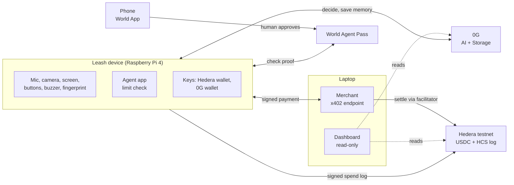
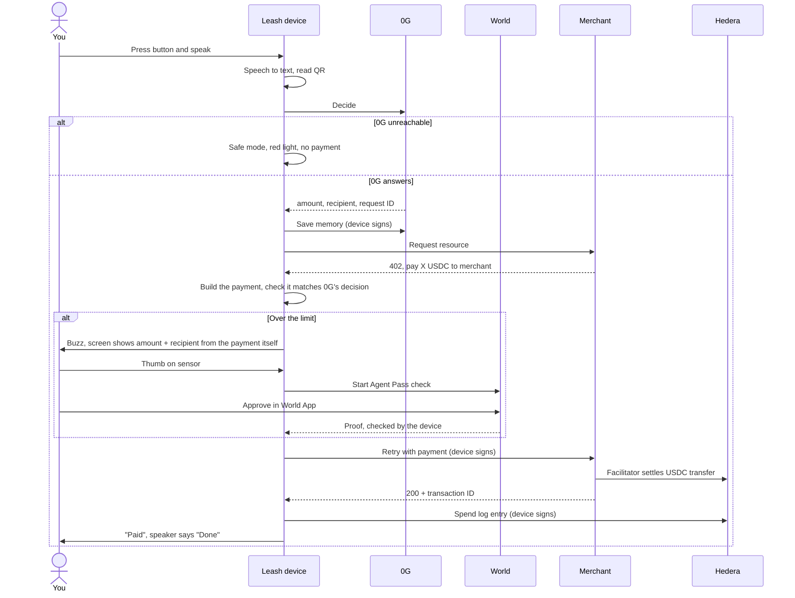

# Leash architecture

0G does the thinking, the device does all the signing. The Leash device (Raspberry Pi 4) runs the agent, enforces the spending limit and holds every key that moves money or writes records. Nothing off the device can make it pay.

## Parts

## One payment, step by step

If the thumb or World check fails, times out or is cancelled, the device never signs, so nothing moves.

## Who signs what

| Key | Lives on | Signs |
|---|---|---|
| Hedera wallet key | Device | Every payment and every spend log entry |
| 0G wallet key | Device | Memory uploads to 0G Storage |
| 0G API key | Device | Nothing, it only authenticates AI calls |
| World client secret | Device | Nothing, it authenticates proof checks with World |
| Fingerprint | Sensor | Nothing, it sends yes/no to the device |
| World proof | Phone | Proof that a human approved |
| Merchant key | Laptop | Setup only (USDC token association) |

## Why this is safe, and where it isn't

- 0G is the agent's brain but signs nothing. A tricked decision still has to pass the device's limit check, and big amounts need your thumb and World ID.
- The screen shows the amount and recipient taken from the payment the device is about to sign, so what you see is what gets paid.
- A hacked phone, laptop or merchant can't make the device sign.
- Weak point: keys are files on the Pi. Someone with root access or the SD card can take them. Production would keep them in a secure element together with the fingerprint check.
