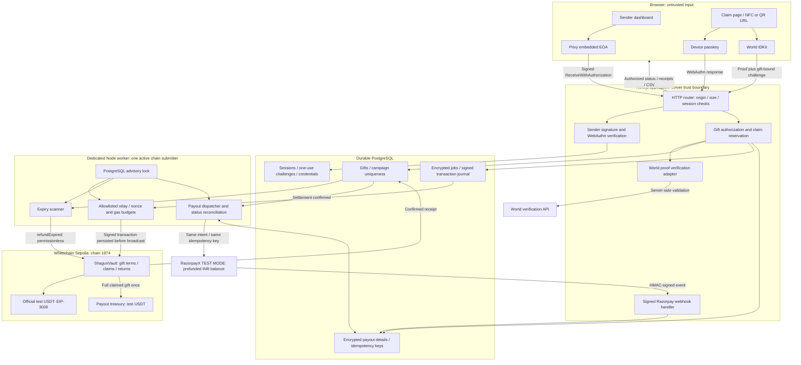
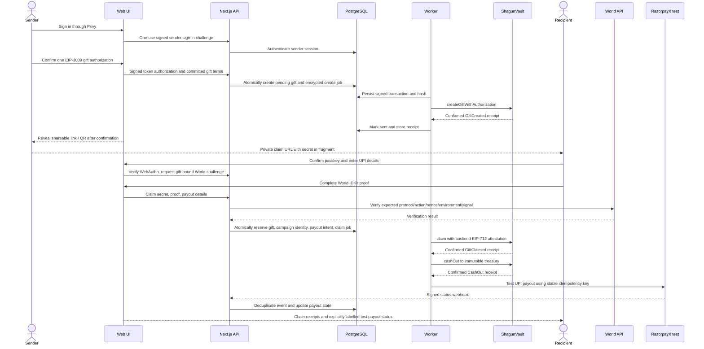
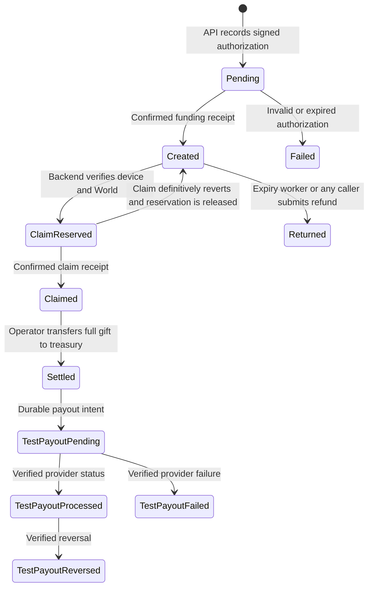

> Current identity decision (Nov 6): World ID is removed. Replace historical World-proof steps below with a fresh passkey session and the private gift-link secret. Campaign limits are per passkey, not per person. See `docs/context.md` and current implementation.

# Shagun architecture

Start here when joining the project. [context.md](./context.md) describes the product; this document describes the implemented boundaries. The [release checklist](./operations.md) records what still prevents a production launch.

Use the [HTTP API reference](./api.md) for route contracts and the [developer guide](./development.md) for setup and contribution procedures.

## System diagram

USDT entering the treasury does **not** convert it to INR. RazorpayX test mode simulates the separate INR payment. A live conversion/payout provider is a production dependency, not an implemented feature. CRE is not currently in the execution path.

## Send and claim sequence

The sender's initial session sign-in is separate from the single gift authorization. Neither requires a sender-paid transaction. Demo sender accounts must be prefunded with official test USDT.

## State and ownership

`ClaimReserved` is a database reservation, not an on-chain claim. The UI displays it as confirmation pending. Contract state is authoritative for tokens. PostgreSQL owns sessions, encrypted work, campaign reservations, and external payout state. The worker projects confirmed receipts into gift records; a full independent event indexer is not implemented.

## Source map

| Path | Responsibility |
| --- | --- |
| `contracts/ShagunVault.sol` | Escrow, sender-term commitment, attested claims, campaign uniqueness, treasury settlement, expiry refunds, admin key rotation and pause |
| `contracts/test/` | Local mock token, excluded from deployment scripts |
| `db/migrations/` | Numbered schema migrations and ordered migration registry |
| `web/src/app/` | Page entry points and thin API route adapter |
| `web/src/components/shagun/` | Landing, dashboard, claim, receipt, and sender-provider UI |
| `web/src/lib/chain.ts` | Public chain configuration, ABI, EIP-712 types, gift nonce commitment |
| `web/src/lib/amounts.ts` | Integer USDT/paise arithmetic and display/export formatting |
| `web/src/lib/server/api.ts` | HTTP routing and safe error envelope; no payment implementation |
| `web/src/lib/server/http/` | Input schemas, bounded body reader, response helpers, authorized reads |
| `web/src/lib/server/auth/` | Sessions, one-use challenges, sender signatures, WebAuthn verification |
| `web/src/lib/server/gifts/` | Gift creation, claim orchestration, and database projection |
| `web/src/lib/server/world/` | RP request signing and strict backend proof verification |
| `web/src/lib/server/payouts/` | RazorpayX test adapter, provider reconciliation, signed webhooks |
| `web/src/lib/server/chain/` | Durable relayer jobs, receipt recovery, settlement, expiry scanner |
| `web/src/lib/server/security/` | AES-GCM encryption, random IDs, keyed human commitments |
| `web/scripts/` | Migration, worker process, chain check, compilation and testnet deployment commands |
| `web/tests/` | Contract and API integration tests |
| `web/e2e/` | Browser journeys, mobile layout, actual WebAuthn verification using a virtual authenticator |
| `deployments/` | Public deployment evidence, created only by a real deployment |

Dependencies point from UI to the HTTP API, and from controllers to domain/repository/adapters. Browser modules must not import server code. No provider credentials, raw proofs, or UPI IDs belong in `NEXT_PUBLIC_*`, URL queries, chain events, or logs.

## Important invariants

- The EIP-3009 nonce commits to chain, vault, sender, amount, expiry, secret hash, bound human, campaign and random salt. Changing any term invalidates the authorization.
- Gift secrets live in private fragment URLs. The sender retains a copy only in the current browser tab's session storage; closing the tab without saving the link loses that copy.
- World uses a stable `shagun-human` action and a fresh signal bound to the gift and passkey session. Pin v4 Proof of Human; confirm repeated-human behavior with real World participants before submission. Never compare unrelated action nullifiers.
- Campaign uniqueness is scoped to `(sender, campaignId, human)`, in both the database and vault. Ordinary gifts remain repeatable.
- Claim reservation, campaign consumption, payout intent, and claim job creation share one atomic SQL statement.
- Only the worker broadcasts transactions. It persists encrypted signed bytes and the hash before sending, then rebroadcasts the same bytes after an uncertain response.
- Payouts require a confirmed treasury-settlement receipt and one stable intent/idempotency key. Uncertain responses are reconciled; they do not authorize another payout intent.
- A processed provider state cannot be overwritten by a delayed processing event. A later authenticated reversal is allowed.
- A separate vault admin can pause new gifts/claims and rotate operational roles. Pause never blocks expiry refunds. Ownership changes use two-step acceptance.
