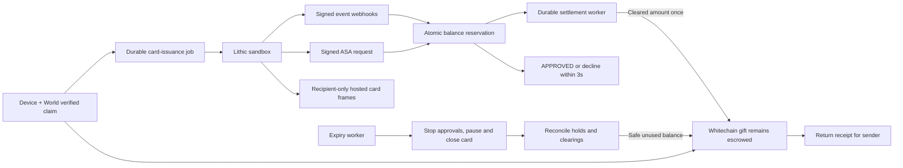

> Current identity decision (Nov 6): World ID is removed. Replace historical World-proof steps below with a fresh passkey session and the private gift-link secret. Campaign limits are per passkey, not per person. See `docs/context.md` and current implementation.

# Card execution plan (Lithic sandbox)

**Decision:** Lithic sandbox virtual cards are the main redemption path. Stripe Issuing was tried first and dropped; do not switch back without an explicit product decision. RazorpayX UPI remains optional and off the critical path. This plan supersedes the UPI-first execution order in `implementation-plan.md`.

Keep the existing website brand and preserve the separately owned landing page. Keep the working sender authorization, passkey, World verification, database, worker, and receipt foundations. Reuse the durable transaction journal and provider idempotency patterns.

## Product promise and limits

Send a gift → claim with device and World → receive a virtual card with a gift-sized spending budget → simulate purchases → see settled spending and returnable funds → close the card at expiry and return reconciled unused USDT.

The card is a **Lithic SANDBOX** card. The sandbox is not connected to card networks, so it cannot buy real goods; purchases are created with Lithic's simulation endpoints. Whitechain transactions remain real testnet operations. The sandbox card budget and the USDT vault are separate ledgers; this integration does not convert USDT into card funds. Show the network of the card program actually used (sandbox has a Mastercard and a Visa test program). Do not make production-country availability claims during this build.

Scope the first demo to USD gifts in whole cents and ordinary USD purchases with clearing amounts no greater than the approved amount. Keep all underlying USDT accounting at six decimals. Decline unsupported request types (`BALANCE_INQUIRY`, credit authorizations) and currencies, and surface any unexpected clearing as a reconciliation exception.

## Principles

1. **Fast authorization, asynchronous chain work.** Auth Stream Access (ASA) gives the responder six seconds and Lithic asks for an answer within three. Verify the signature, atomically reserve available balance in PostgreSQL, answer `{ token, result }`. Chain confirmation is never on this path. Any failure after verification declines. [ASA](https://docs.lithic.com/docs/auth-stream-access-asa)
2. **Retries must be idempotent.** Lithic retries ASA immediately on a 5xx or network failure, so the same transaction can arrive twice. Key reservations on the ASA `token` and return the recorded decision on a repeat.
3. **Approval is a hold, not final spending.** Settle on clearing events by unique transaction event, not by authorization alone. Track partial clearings, voids and returns in the ledger. [Simulating transactions](https://docs.lithic.com/docs/simulating-transactions)
4. **Lithic limits are defense in depth.** Set a `FOREVER` card spend limit equal to the gift, but decisions come from the locked balance ledger. Pre-ASA checks (spend limits, card state) may decline before our endpoint sees the request.
5. **Expiry is a closing process.** Stop approvals, pause then close the card, reconcile outstanding holds and clearings, then release only money no longer reserved.
6. **Return trust must be stated honestly.** Unclaimed envelopes keep permissionless expiry refunds. Returns from a claimed card depend on off-chain reconciliation and an authorized on-chain closure.

## Execution boundaries

## Phase 0 — prove sandbox access (built, waiting for a key)

- `server/cards/lithic.ts` calls only `https://sandbox.lithic.com/v1` with `LITHIC_API_KEY`, and verifies Lithic's `webhook-id`/`webhook-timestamp`/`webhook-signature` HMAC (five-minute tolerance, rotated signatures accepted).
- `/api/webhooks/lithic/asa` approves only a card tagged `purpose=shagun-phase0`, USD, 1–2,500 cents, `AUTHORIZATION`/`FINANCIAL_AUTHORIZATION`; everything else declines. `/api/webhooks/lithic/events` records each `webhook-id` once.
- `pnpm lithic:phase0` checks the key, enrolls the ASA responder, subscribes events, creates a paused virtual card with a $25 `FOREVER` limit then opens it, and simulates authorize/clearing. It saves secrets to `web/.env.local` without printing them.
- `/dev/card` (development only) mounts PAN, expiry and CVV through `lithic-embed` in sandbox mode, using a five-minute `CARD_EMBED` session created by our backend. Card details never touch our server.
- Lithic needs a public HTTPS URL for ASA and events, and the embed `target_origin` must match the page origin, so run behind a tunnel and set `APP_URL` to it.

**Exit gate:** real sandbox card token, the card shown through hosted frames, an $8 simulated authorization approved by our ASA endpoint and then cleared, and a $30 one declined. Report access blockers immediately.

## Phase 1 — balance and contract rules

Replace the whole-gift settlement assumption before connecting cards to claims.

- Append-only migrations for redemption selection, card issuance jobs, card references, ASA decisions/reservations (unique on ASA `token`), clearings/voids/returns, ledger entries, processed event IDs, and closure/reconciliation state. Never alter applied migrations.
- Integer USD cents and USDT micro-units: 1 USD of card budget per 1 USDT, 10,000 micro-units per cent, as a configured sandbox convention. Reject gifts that cannot map exactly to cents.
- Track `funded`, `reserved`, `cleared`, `chainSettlementPending`, `returned`, and exceptions separately. Serialize decisions with a row lock.
- Evolve the vault to allow partial `spend(giftId, amount, transactionRef)` with unique references and tracked remaining balance.
- Preserve immediate unclaimed expiry return. Add an explicit claimed-card closing state; claimed card funds are released only by an authorized reconciliation checkpoint.
- Extend the ABI, worker operation allowlist, gas policy, projection, and tests together. A new vault deployment is required.

**Exit gate:** tests prove no double spend, no duplicate clearing settlement, and no refund of money still reserved for pending purchases.

## Phase 2 — claim to virtual card

- Keep passkey and backend World checks. Record the redemption mode atomically; default to `card`.
- After a confirmed claim, enqueue issuance instead of the whole-gift `cashOut` job. One card per gift, enforced by a unique database relationship; tag the card with the gift ID.
- Create the card `PAUSED`, set `spend_limit` to the gift and `spend_limit_duration: FOREVER`, and open it only once the ledger row exists. Show `preparing card` until then.
- Add `server/cards/issuance.ts` and thin card-read/embed-session controllers. Derive the card from the authenticated claimant; never trust a browser-supplied card token.
- Add `CardWallet.tsx` for network, last four, budget, available funds, expiry, sandbox badge, and the hosted frames. Keep card details out of sender history and QR links.

**Exit gate:** a claimed testnet gift produces one sandbox card visible only to the recipient. Duplicate claims do not issue another card.

## Phase 3 — purchases and settlement

- Under a short transaction: validate card, gift expiry, currency/status and available budget; reserve; persist the decision keyed by ASA `token`; respond. A repeat returns the recorded decision.
- On `card_transaction.updated` events, release reservations for declined/voided authorizations and move cleared amounts into spending, enqueuing a unique `spend` job. Chain failure leaves `settlement pending` and blocks unsafe refunds.
- Test purchases go through an operator-only, sandbox-only control that calls `simulate/authorize` and `simulate/clearing`. A client flag must never unlock them.

**Exit gate:** a $25 card buys $8, shows $8 spent and $17 available, and links the on-chain settlement. A concurrent or excessive request is declined.

## Phase 4 — close and return unused funds

- At expiry, mark the gift closing (new ASA requests decline), pause then close the card idempotently.
- Reconcile the card's transactions, including missed events. Close the vault allocation only after holds are cleared or voided and chain jobs have settled.
- For the scripted demo, explicitly clear or void every simulated authorization, then return the remainder on Whitechain.

**Exit gate:** send $25 → spend $8 → close → return $17, with the chain receipts and the Lithic sandbox transaction. Also show an unclaimed gift returning $25.

## Phase 5 — integration checks and handoff

- Test duplicate/out-of-order events, retried ASA requests, simultaneous purchases, slow responses, expired cards, unsupported currency/status, unauthorized card-detail access and issuance retries.
- Measure ASA response time against the three-second target.
- Exercise the hosted frames on a phone using a real claim; confirm card details are absent from our responses and logs.
- Update sender history/CSV, README, environment example and runbook as work lands. Keep the 05:00 feature freeze and 08:30 submission target.

**Exit gate:** reproducible send → claim → show card → purchase → declined purchase → unused return, with sandbox labels and real provider/chain evidence.

## Phase 6 — optional, only after the card demo passes

RazorpayX UPI as an alternative redemption before card activation; one mode per gift. CRE only if it stays outside the synchronous ASA path. No ENS, wallet provisioning, production coverage or FX work before the deadline.
