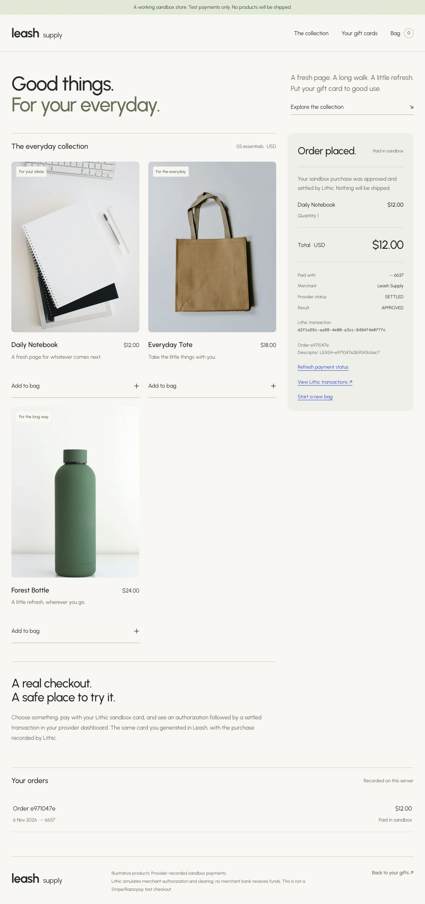

# App readiness — 6 November 2026

## Implemented on `codex/end-to-end-gifting`

- Browser wallet connection and EIP-191 ownership sign-in with single-use five-minute challenges, origin binding and eight-hour signed HttpOnly sessions.
- Persistent purchase orders for self or another recipient wallet; wallet-filtered sent/received gift lists.
- Fixed 100 test-USDC checkout on Base Sepolia only. Direct transfer, no unlimited approvals, and buyer balance/network checks.
- Server verification of network, Circle USDC contract, sender, treasury, amount, calldata, Transfer log, success, canonical block, order age and three confirmations.
- Global transaction claims prevent reusing one payment for another gift. Treasury self-payments are rejected at creation and verification.
- Only the recipient may issue/view the purchased card after payment. Payment is checked again before calling Lithic. Separate per-order provider reservations prevent duplicate cards and recover uncertain outcomes.
- Actual provider masked card, expiry, status and spending limit. No fabricated PAN, local fake balance or fake purchase button.
- Payment-hash persistence and manual replacement/recovery verification without automatically sending again.
- Previous standalone Lithic fixture/card preserved at `/sandbox`, separate from purchase orders.

## Verified

- TypeScript and ESLint pass; **40 tests across seven files pass**.
- Production build passes for checkout, wallet/order API routes and the standalone sandbox.
- Live Base Sepolia RPC returned chain ID 84532 and deployed code for Circle's USDC test contract.
- Running-app HTTP smoke test used a newly generated in-memory test wallet to sign a genuine ownership challenge. Login succeeded; replay was rejected. A real-RPC-based order was created, unpaid card issuance was blocked, an unknown hash stayed pending (not paid), and cross-origin writes were rejected. The unpaid smoke-test order was removed afterward; no tokens or new provider cards were created by this test.
- Unit tests cover valid payment evidence and rejection of wrong chain/sender/token/recipient/amount/hash, failed/old/reorged/missing-log evidence, insufficient confirmations, treasury self-payments, duplicate payment claims, recipient access, signature tampering/expiry and provider recovery.
- Static review found a treasury self-payment edge case. Regression tests reproduced it, the server-side checks were added, and the reviewer verified the fix.
- The underlying Lithic integration previously created actual sandbox card **6637**, verified separately in the provider dashboard. This fixture is preserved; it is not falsely attributed to a paid checkout order.

## User-dependent testing still outstanding

The user will test the actual wallet transfer themselves. The in-app browser has no injected EVM wallet provider. No end-to-end funded checkout or newly issued purchased card has yet been demonstrated onchain. Use a wallet-enabled browser and 100 Base Sepolia test USDC plus test ETH, then follow the README walkthrough. A browser ownership signature is not a token transfer.

## Boundaries

Testnet USDC is paid to a configured testnet treasury. It is not converted into or deposited on a Lithic card. Lithic independently issues sandbox cards with spending limits. No live money, live KYC, Bridge/Stripe funding, live card spending or in-app provider transaction simulator is implemented.

Local filesystem records/locks and process-local throttling require a single persistent Node deployment. Preserve all data across restarts. Lost order/claim/reservation records can permit duplicate use. After a crash, inspect unresolved locks and provider/payment outcomes before any manual repair; do not reset paid gift data blindly. Public/distributed/production use requires transactional storage, operational recovery, stronger rate limits and identity/funding/programme work.

## Sandbox ecommerce verification — 2026-11-06

`/shop` now provides a product catalog, quantity cart, server-calculated prices, authorized issued-card selection and persistent order history/receipts. Both recipient-issued cards and the existing operator fixture are supported. Provider-backed checkout uses actual Lithic sandbox authorization and clearing; this is not a Stripe/Razorpay checkout or merchant-bank payout.

Verified against the running production build:

- Bought one Daily Notebook for **$12.00 sandbox USD**, operator card ending **6637**.
- Lithic transaction `d2f1a55c-aa69-4e00-a3cc-8494f4e0f7fc`: **SETTLED / APPROVED**, settlement 1200 cents, exactly one AUTHORIZATION and one CLEARING event.
- Initially delayed transaction visibility and provider descriptor truncation were recovered on the same saved order, without sending another authorization. New descriptors are 20 characters; recovery supports the provider's 22-character truncation of earlier descriptors.
- Repeated payment POST returned the same PAID order and transaction; provider still had exactly one transaction. Unauthenticated receipt GET returned 401.
- Receipt survived browser reload; desktop and 390px mobile checkout inspected; no browser console warnings/errors after reload.
- `pnpm check`: TypeScript, ESLint and **46 tests across eight files** pass. `pnpm build` passes. Impeccable static detector reports no findings in the shop UI.

The test used the preserved operator fixture. It does not demonstrate the user's actual Base Sepolia wallet payment or recipient issuance. Those remain user-tested steps. No real money moved, no merchant bank received funds, and nothing ships. Card limits are sandbox spending controls, not a crypto-funded balance. Preserve all `.data/lithic/shop` records; ambiguous clearing is never automatically retried and may need operator review.

