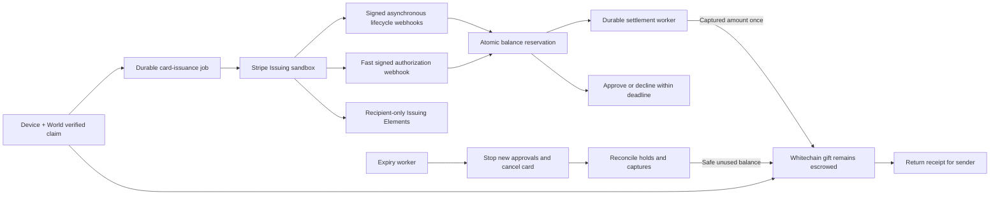

# Stripe-first execution plan

**Decision:** Stripe Issuing sandbox virtual cards are the main redemption path. RazorpayX UPI remains optional and off the critical path. This plan supersedes the UPI-first execution order in `implementation-plan.md`. It describes proposed work; Stripe card functionality is not yet implemented or verified in this repo.

Keep the existing website brand and preserve the separately owned landing page. Keep the working sender authorization, passkey, World verification, database, worker, and receipt foundations. Reuse the durable transaction journal and provider idempotency patterns.

## Product promise and limits

Send a gift → claim with device and World → receive a virtual card with a gift-sized spending budget → simulate purchases → see captured spending and returnable funds → close the card at expiry and return reconciled unused USDT.

The card is **Stripe Issuing TEST MODE**. It cannot be used to buy real goods. Whitechain transactions remain real testnet operations. Stripe's prefunded sandbox USD balance and the USDT vault are separate ledgers; this integration does not automatically convert USDT into Stripe funds. Display the actual network/brand returned by Stripe; use Visa branding only if the created card is Visa. Do not make production-country availability claims during this build.

Scope the first demo to USD-denominated gifts in whole cents and ordinary USD purchases with capture amounts no greater than the approved amount. Keep all underlying USDT accounting at six decimals. Reject unsupported authorization types/currencies on the supported request path, document network exceptions, and surface any unexpected capture as a reconciliation exception. Additional capture liabilities need a separate treasury policy before production.

## Corrections to the proposed flow

1. **Fast authorization, asynchronous chain work.** Verify the webhook and atomically reserve available balance in PostgreSQL, then answer the synchronous request. Configure timeout/error behavior to decline. Chain confirmation is outside this request path; the two-second window is too short to rely on it. [Stripe real-time authorization](https://docs.stripe.com/issuing/controls/real-time-authorizations)
2. **Approval is a hold, not final spending.** Settle confirmed captures using unique Stripe transaction references. A single authorization can have multiple transaction events; do not deduplicate all spending solely by authorization ID. Track changes, reversals and partial captures in a ledger. [Stripe authorization lifecycle](https://docs.stripe.com/issuing/purchases/authorizations)
3. **Stripe limits are defense in depth.** Add an all-time card spending limit, but use a locked balance ledger for concurrent decisions. Stripe documents delayed spend aggregation and possible over-capture. Do not promise a universal hard cap solely from the card setting. [Stripe spending controls](https://docs.stripe.com/issuing/controls/spending-controls)
4. **Expiry is a closing process.** Stop approvals, deactivate/cancel the card, reconcile outstanding authorizations and captures, then release only money no longer reserved. Card cancellation alone does not establish that approved purchases cannot settle. [Stripe capture behavior](https://docs.stripe.com/issuing/purchases/transactions)
5. **Return trust must be stated honestly.** Unclaimed envelopes can retain permissionless expiry refunds. Returns from a claimed card depend on off-chain reconciliation and an authorized on-chain closure. Do not describe that entire path as issuer-independent or instantly trustless at expiry.

## Proposed execution boundaries

## Phase 0 — prove account access, 30–45 minutes

Before migrating the product around Stripe, prove the actual account supports the needed sandbox APIs.

- Set `STRIPE_SECRET_KEY`, `NEXT_PUBLIC_STRIPE_PUBLISHABLE_KEY`, and separate signing secrets for synchronous authorization and asynchronous events, all through the environment. Require sandbox/test credentials and validate `livemode: false` on provider objects/events.
- Verify the intended US sandbox account has Issuing enabled and an available Issuing test balance. Do not infer this from ordinary Stripe Payments access.
- Create a test cardholder using explicit sandbox fixture billing details and any required test identity fields. Create an inactive virtual USD card, then prove activation with a 2,500-cent all-time budget. Use stable creation idempotency keys. Confirm the returned card brand. [Card creation API](https://docs.stripe.com/api/issuing/cards/create)
- Prove the authenticated Issuing Elements nonce/ephemeral-key flow in a small isolated test screen. Keep PAN and CVC inside Stripe-hosted elements and out of app logs, storage and JSON responses. Confirm sensitive details and key refresh work with the pinned API version. [Issuing Elements](https://docs.stripe.com/issuing/elements)
- Expose a signed authorization endpoint and simulate a purchase with the actual test helper. Inspect the real event shape and decision response.

**Exit gate:** real sandbox card ID, actual returned brand, successful Elements display, and an actual test authorization reaching our endpoint. This phase may encounter an external access blocker. Report that immediately while continuing independent ledger/contract work; do not substitute invented cards or another issuer without an explicit product decision.

## Phase 1 — establish balance and contract rules, 60–90 minutes

Replace the whole-gift settlement assumption before connecting cards to claims.

- Add append-only migrations for redemption selection, card issuance jobs, card references, authorization decisions/reservations, captures/reversals, ledger entries, processed event IDs, and closure/reconciliation state. Never alter the already applied initial migration.
- Use integer USD cents and USDT micro-units. Proposed demo mapping is 1 USD of card budget per 1 USDT, with 10,000 micro-units per cent, explicitly a configured sandbox accounting convention. Reject gifts that cannot map exactly to cents in the card path.
- Track `funded`, `reserved`, `captured`, `chainSettlementPending`, `returned`, and exceptions separately. Display available balance without subtracting the same capture twice. Serialize decisions with a row lock/transaction; all channels draw from the same underlying gift.
- Evolve the vault to allow partial `spend(giftId, amount, transactionRef)` with unique references and tracked remaining balance. The reference is derived from the actual captured transaction, and the full reference remains off-chain in the receipt record.
- Preserve immediate unclaimed expiry return. Add an explicit claimed-card closing/finalization state; hold claimed card funds until an authorized reconciliation checkpoint releases safely returnable funds. After that checkpoint, anyone can submit the permitted return transaction. Block spends/returns from consuming each other's allocation.
- Extend the ABI, worker operation allowlist, gas policy, projection, and tests together. A new vault deployment/verification is required; the current contract cannot support partial card spending or claimed-balance returns.

**Exit gate:** tests prove no double spend, no duplicate capture settlement, and no refund of money still reserved for supported pending purchases. The claimed-card closure trust boundary is documented.

## Phase 2 — claim to virtual card, 45–60 minutes

- Keep passkey and backend World checks. Record the selected redemption mode atomically; default to `card`.
- After a confirmed claim, enqueue issuance rather than the existing whole-gift `cashOut` job. Create/recover one card per gift using provider idempotency and a unique database relationship.
- Keep the card inactive until the gift, account mapping, authorization endpoint and spending controls are ready. Activate only after those checks; show `preparing card` until confirmed. Failure leaves the escrow claim recoverable and visible.
- Add `server/cards/stripe.ts`, `server/cards/issuance.ts`, and thin card-read/ephemeral-key controllers. Derive the permitted card from the authenticated gift/claimant; never trust an arbitrary `card_id` supplied by the browser.
- Replace the required UPI form with the minimal sandbox cardholder details. Add `CardWallet.tsx` for actual brand, last four, budget, available funds, expiry, test badge, and recipient-only Issuing Elements. Keep full card details out of sender history and QR links.

**Exit gate:** a real claimed testnet gift produces one sandbox card visible only to the authorized recipient. Duplicate claim/job attempts do not issue another card.

## Phase 3 — purchases and settlement, 60–90 minutes

- Add `server/cards/authorizations.ts` for the fast decision path and `server/cards/events.ts` for durable asynchronous processing. Pin Stripe API/SDK versions and use Stripe's official raw-body signature verification.
- Under a short database transaction: validate card, mode, gift expiry, supported currency/type and available budget; reserve the requested amount; persist a stable decision before responding. A duplicate request returns that recorded decision. A failed reservation declines.
- Reconcile the actual authorization-created/updated result. Release a local reservation when approval did not actually occur. Record out-of-order/repeated delivery without double counting.
- On supported capture events, move the relevant reservation into captured spending and enqueue a unique `spend` job. The durable relayer submits it and attaches the receipt. Chain/RPC failure leaves `settlement pending`, retains liability coverage, and prevents unsafe refunds.
- Handle reversal/release and partial capture explicitly. Keep future refunds/credits in a separate ledger branch; do not reopen or credit an expired gift automatically. Flag unexpected over-capture/late capture rather than silently consuming another gift's funds.
- Put test-purchase controls behind authenticated operator access and a sandbox flag. A client-provided `testMode=true` must never grant access to test helpers.

**Exit gate:** a simulated $25 card buys $8, displays $8 captured and $17 available, and links the corresponding on-chain settlement. A concurrent or excessive request is declined without a second allocation.

## Phase 4 — close and return unused funds, 45–60 minutes

- At expiry, atomically mark the gift closing and reject new authorization decisions. Make provider cancellation idempotent and record confirmation.
- Fetch/reconcile the card's relevant authorizations and transactions, including undelivered events. Confirm supported outstanding holds are captured or definitively released and their chain jobs have settled before closing the vault's card allocation.
- For the scripted sandbox demo, explicitly capture or reverse every simulated authorization. Then finalize closure and return the reconciled remainder on Whitechain. The UI distinguishes expiry, closing/reconciliation, and confirmed return.
- Keep cancellation, closure and return as separate retryable stages. A timeout or failed provider cancellation cannot be interpreted as proof that funds are unused. Merchant refunds after closure remain reconciliation items under an explicit later policy.

**Exit gate:** send $25 → capture $8 → cancel/close → return $17, with the two real chain receipts and the genuine Stripe sandbox transaction. Also demonstrate a completely unclaimed gift returning $25.

## Phase 5 — integration checks and handoff, 60–90 minutes

- Test duplicate/out-of-order webhooks, simultaneous purchases, failed/timed-out authorization responses, expired cards, unsupported currency/type, missing card requirements, unauthorized card-detail access, issuance retries and expiry while a hold is outstanding.
- Verify the synchronous endpoint's measured response time with headroom under Stripe's deadline; use decline fallback. Test missing/invalid signatures and `livemode: true` rejection.
- Exercise Elements in the target phone browser using the actual authenticated claim. Validate full card details are absent from our network responses/logs and key expiration refresh is correct.
- Update sender history/CSV to funded, captured, reserved, return pending and returned values. Update the actual architecture, API reference, README, environment example and recovery runbook as implementation lands.
- Coordinate wording and illustrations with the landing-page developer. Keep the same brand. Do not promise real purchases from test cards or immediate issuer-independent return of claimed card funds.
- Run existing checks plus new card tests, rehearse the full flow, and record genuine sandbox behavior. Preserve the 05:00 feature freeze and 08:30 submission target from the context.

**Exit gate:** reproducible send → claim → show card → purchase → denied purchase → unused return, with clear test labels and real provider/chain evidence.

## Phase 6 — optional work only after the card demo passes

RazorpayX UPI may be offered as an alternative redemption choice before card activation. Do not allow card purchases and a full UPI cash-out against the same budget. Switching an active card requires the same cancellation/hold reconciliation process before transferring funds. Initially choose one redemption mode irrevocably per gift.

Consider CRE only if it can add a working, demonstrable integration without entering the synchronous authorization path. Do not spend deadline time on ENS, Apple/Google wallet provisioning, production country coverage, international FX, or a general issuing platform.

## Order and estimated effort

The core phases total approximately **5–7 hours of implementation/integration effort after the current foundation**, depending on Stripe access and live World/Whitechain setup. This is an estimate, not a guarantee. Access checks start first; ledger/contract changes precede enabling purchase authorization. Phase 0 is the immediate next action. No card/purchase UI should be treated as complete before its provider-backed exit gate passes.
