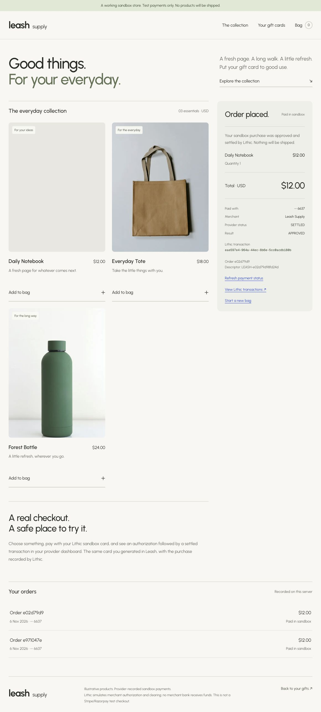

# sai-trail merge and end-to-end verification

Date: 2026-11-06 (Asia/Kolkata).

Merged `origin/main` at `f9ba7e6` into `codex/end-to-end-gifting` in merge commit `f31f878`, then created `sai-trail` from the result. Conflicts resolved in eight files. Main's landing page, header, wallet provider, database/worker/contracts and additional routes are preserved. The received-pass demo remains at `/gifts`; `/shop` keeps its local operator-session authorization. Main's original setup notes are preserved in `docs/main-context.md` and `docs/main-readme.md`. Combined Next config retains main's security headers and the CSS-module loader fix needed by the demo.

## Checks passed

- Frozen-lockfile dependency install.
- Regenerated Next route types (old generated types referenced routes removed by main).
- TypeScript and ESLint.
- 68 tests across 13 files, including main's API, vault and card tests.
- Production build with all merged routes.
- Local `/` and `/api/health` returned 200.
- Browser `/dashboard` rendered its new form and service-availability status; no fabricated gifts were shown.

## Actual Lithic sandbox checkout

1. Opened `/gifts` in the existing authenticated session; recovered the same card ending 6637.
2. Followed **Shop with this card**, added one Daily Notebook ($12).
3. Created order `e02d79d9-8fd2-4d48-9d4a-4695c8a09943`.
4. Lithic's initial transaction read briefly returned 404. Recovery found the authorization; explicit settlement used that same transaction.
5. Provider transaction `eae597e4-964a-44ec-8b6e-5cc0acdb180b` is SETTLED / APPROVED for 1200 cents, with exactly one AUTHORIZATION and one CLEARING event.
6. Repeated payment POST returned the same PAID transaction. Unauthenticated receipt read returned 401; invalid-origin order creation returned 403.
7. Reload preserved the receipt. Browser console returned no warnings/errors on the reloaded store.

Existing card and earlier receipt were preserved. This tested recovery of an existing card, not a fresh card issuance. No real money or goods moved.

## Still unverified / external setup required

The added main application is not the standalone demo. This environment has no DATABASE_URL, DATA_ENCRYPTION_KEY, VAULT_ADDRESS, WORLD_APP_ID or APP_URL. Its complete sender → Whitechain → recipient/World → card/worker lifecycle was not run. The in-app browser also has no injected EVM wallet. Unit/integration tests use local test infrastructure and do not establish live Whitechain/provider configuration. Do not describe this as full Whitechain settlement verification.

The existing separate `/gifts` → `/shop` demo needs only the Lithic sandbox key, local access code and preserved `.data/lithic` files. It has no live KYC, crypto conversion, bank settlement or shipping.
